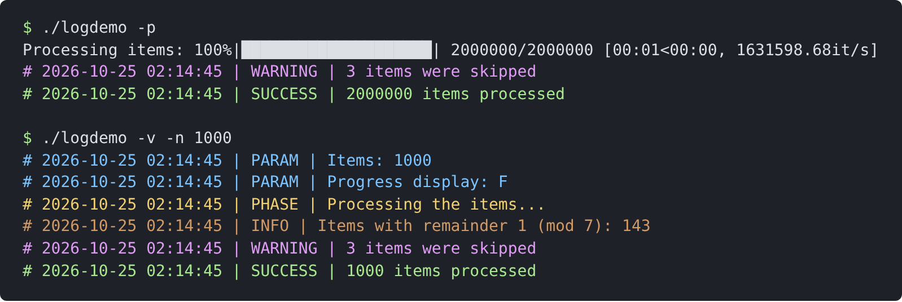
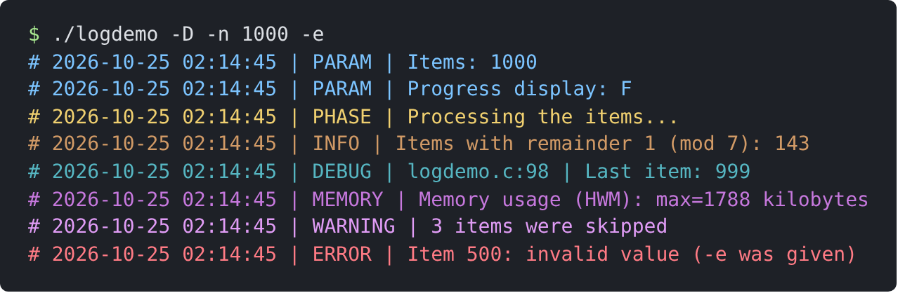

.. _core:

The core component
------------------

The ``core`` component provides the base functionality of a command line
program; it is used by all other components.

Memory allocation (``alloc.h``)
~~~~~~~~~~~~~~~~~~~~~~~~~~~~~~~

Memory is allocated with macros which exit the program with an error
message if the allocation fails, so that the result never needs to be
checked. They are statements (not expressions): the pointer is the first
argument.

``XMALLOC(ptr, size)``
   ``ptr = malloc(size)``
``XCALLOC(ptr, nitems, itemsize)``
   ``ptr = calloc(nitems, itemsize)``
``XREALLOC(ptr, size)``
   ``ptr = realloc(ptr, size)``
``XFREE(ptr)``
   ``free(ptr)``, then ``ptr = NULL``
``XCHECKSPACE(ptrptr, capptr, req)``
   grow ``*ptrptr`` to ``req`` bytes, if its capacity ``*capptr`` is
   smaller
``XCHECKSPACEINC(ptr, capptr, req, inc)``
   grow to ``req + inc`` bytes, if needed
``XCHECKSPACEINCPERC(ptr, capptr, req, p)``
   grow to ``req`` plus ``p`` percent, if needed

The sizes are in bytes. ``XCHECKSPACEINCPERC`` is the usual way of
growing a dynamic array, with amortized constant time appends:

.. code-block:: c

   int *values = NULL;
   size_t n = 0, cap = 0;   /* cap: capacity in bytes */
   while (...) {
     XCHECKSPACEINCPERC(values, &cap, (n + 1) * sizeof(int), 50);
     values[n++] = next_value;
   }
   free(values);

(note that ``XCHECKSPACE``, unlike the other two, takes a pointer to the
buffer pointer). Compiled with ``-DSHOW_TRACES``, each allocation is
traced on the standard error.

.. _logger:

Logging (``logger.h``)
~~~~~~~~~~~~~~~~~~~~~~

A ``Logger`` writes messages to the standard error or to a log file,
with a level; it shows the messages up to its own level:

=================  ==========  ==================================================
level              shown by    meaning
=================  ==========  ==================================================
``LOG_ERROR``      always      the program is interrupted
``LOG_WARN``       always      a problem, but the program continues
``LOG_SUCCESS``    not ``-q``  an operation was completed successfully
``LOG_PHASE``      ``-v``      start or end of a phase of the program
``LOG_INFO``       ``-v``      additional information
``LOG_PARAM``      ``-v``      the values of the parameters
``LOG_MEM``        ``-D``      memory usage (``showmem()``)
``LOG_DEBUG``      ``-D``      debugging information
``LOG_TRACE``      (traces)    used by ``TRACE()`` and ``DEBUG_TRACE()``
=================  ==========  ==================================================

Each message is preceded by the time and the level; at the debug levels
also by the source file and line. When the messages go to a terminal,
each level has its own color, so that warnings and errors stand out
among the other messages; in a log file (``-g``), or when the standard
error is redirected, the colors are not used.

The example program ``logdemo`` (``docs/manual/examples/logdemo.c``)
outputs a message at each level. With the default level, only the
warnings, errors and success messages are shown; ``-v`` adds the
parameters, the phases and the information messages
(:numref:`fig-term-logger`); ``-D`` adds the debugging messages, with
the source file and line, and the memory usage
(:numref:`fig-term-debug`).

.. _fig-term-logger:

   The messages of ``logdemo`` with the default level (with a progress
   display, ``-p``) and in the verbose mode (``-v``).

.. _fig-term-debug:

   All levels (``-D``): parameters (blue), phase (yellow), information
   (orange), debug (cyan, with the source file and line), memory usage
   (magenta), warning (light magenta), and the error which ends the
   program (red; ``-e`` makes the ``LCHECK`` of the example fail).

The code which produced these messages:

.. literalinclude:: examples/logdemo.c
   :language: c
   :start-at: lprintf(logger, LOG_PHASE
   :end-at: lprintf(logger, LOG_SUCCESS

The functions and macros:

``Logger* new_logger(FILE *logfile, LoggingLevel level)``
   create a logger; the programs usually create it with ``INIT_LOGGER``
   (see below), from the options;
``void delete_logger(Logger *logger)``
   delete it (closing the log file, if not the standard error or
   output);
``lprintf(logger, level, fmt, ...)``
   output a message (printf-like; the format includes the final newline);
``lnprintf(logger, level, fmt, ...)``
   continue a line started with ``lprintf()``, without the prefix;
``LCHECK(condition, logger, fmt, ...)``
   if the condition is false, output an error message and exit with
   ``EXIT_FAILURE`` (deleting the logger, which closes the log file);
``fatal_printf(fmt, ...)``
   output an error and exit, where no logger is available;
``showmem(logger)``
   output the memory used by the program (peak resident set size), at
   level ``LOG_MEM``;
``TRACE(fmt, ...)``, ``NTRACE(fmt, ...)``
   temporary debugging output; ``DEBUG_TRACE``/``DEBUG_NTRACE`` are
   compiled only with ``-DSHOW_TRACES``.

``LCHECK`` is the usual way of checking the input and the results of
system calls:

.. code-block:: c

   LCHECK(n_fields == 3, logger, "File %s, line %zu: 3 fields expected, "
          "%zu found\n", filename, lineno, n_fields);

All functions accept ``NULL`` as logger: then only errors are shown.

.. _argparse:

Command line interface (``argparse-def.h``)
~~~~~~~~~~~~~~~~~~~~~~~~~~~~~~~~~~~~~~~~~~~

``argparse-def.h`` is a header of macros, which give all programs the
same command line interface: the common options, the error messages and
the help. :ref:`quickstart` shows a complete example; the elements are:

**The help.** The program defines ``PURPOSE`` (the help text, with ``%s``
for the program name, ending with ``COMMON_OPTS_HELP``) and, before
including the header, ``VERSION``. ``STR(x)``/``XSTR(x)`` stringify a
token or the value of a macro; ``BOOLSTR(b)`` gives ``"T"`` or ``"F"``.

**The common options**, handled by ``COMMON_OPTS_PARSE_CASES``:

=====================  ===================================================
``-q``, ``--quiet``    level ``LOG_WARN``: no success messages
``-v``, ``--verbose``  level ``LOG_PARAM``: information and parameters
``-D``, ``--debug``    level ``LOG_DEBUG``
``-g``, ``--logfile``  write the messages to a file
``-h``, ``--help``     output the help (``PURPOSE``) and exit
``-V``, ``--version``  output the program name and ``VERSION`` and exit
=====================  ===================================================

Only one of ``-q``, ``-v`` and ``-D`` can be given. A program which
needs the letter ``g`` for another option defines ``LOGFILE_OPT``,
``LOGFILE_OPT_STR`` and ``LOGFILE_OPT_HELP`` before including the
header.

**Parsing.** In ``parseargs()``:

* ``PARSE_START`` declares the variables of the common options;
* ``getopt()`` is called with ``COMMON_OPTS_STR`` appended to the
  string of the options; with ``getopt_long()``, the table of the long
  options contains ``COMMON_LONGOPTS`` and ends with ``LONGOPTS_END``::

     static struct option longopts[] = {
       {"threads", required_argument, NULL, 't'},
       COMMON_LONGOPTS
       LONGOPTS_END
     };

* the ``switch`` ends with ``COMMON_OPTS_PARSE_CASES``; set
  ``opterr = 0`` before the loop, so that unknown options are reported
  by the library;
* ``INIT_LOGGER(logger)`` creates the logger after the parsing;
  ``PARSE_LOG(fmt, ...)`` logs the parameters (level ``LOG_PARAM``).

**Values and errors.** The macros report the errors, followed by the
usage, and exit:

``PARSE_INTEGER_OPT_MIN(c, ptr, min)``
   parse the integer value of the option ``c`` into ``*ptr`` (``long``),
   at least ``min``
``PARSE_INTEGER_OPT_MIN_MAX(c, ptr, min, max)``
   the same, between ``min`` and ``max``
``PARSE_INTEGER_ARG_MIN(n, ptr, min)``
   the same, for the ``n``-th positional argument (from 0)
``CHECK_NARGS(n)``, ``CHECK_MIN_NARGS(n)``
   check the number of positional arguments
``OPT_ERR(c, fmt, ...)``
   an error in the option ``c``
``ARG_ERR(n, fmt, ...)``
   an error in a positional argument
``PARSE_ERR(fmt, ...)``
   another error of the command line

``argparse_long(s, &value)`` parses a whole string as a decimal integer
(returning ``false`` if it is not valid), for values which are not
directly an option, e.g. the parts of an option value.

Files and directories (``file.h``)
~~~~~~~~~~~~~~~~~~~~~~~~~~~~~~~~~~

The wrappers of the standard file operations have the name of the
standard function with a prepended ``x``; they exit the program with an
error message (with the file name and the system error) if the
operation fails:

======================================================  ======================
``xfopen(fname, sfx, mode, description, logger)``       ``fopen()``
``xfclose(&file, logger)``                              ``fclose()``, sets the
                                                        pointer to NULL
``xfread(ptr, size, nmemb, file, logger)``              ``fread()``, all
                                                        elements
``xfwrite(ptr, size, nmemb, file, logger)``             ``fwrite()``, all
                                                        elements
``xgetline(&line, &size, file, logger)``                ``getline()``; false at
                                                        the end of the file
``xgetdelim(&line, &size, delim, file, logger)``        ``getdelim()``
``xfunlink(fname, sfx, logger)``                        ``unlink()``
``xfrename(old, sfx_old, new, sfx_new, logger)``        ``rename()``
======================================================  ======================

The file name is given as a name and a suffix (``NULL`` if none), which
are concatenated; the description (e.g. ``"input reads"``) is used in
the debug messages. Further functions:

* ``file_exists(fname, sfx)`` and ``file_size(file)``;
* ``read_file(file, &buffer, &size, logger)``: read a whole file into an
  allocated buffer;
* ``read_lines_in_buffer(file, buffer, bufsize, &lines, &linesbufsize,
  logger)``: read as many complete lines as fit into a buffer, and split
  them (used by the file sorter);
* ``xfmap()``/``xfunmap()``: map a file into memory;
* ``xfopen_chksig()``, ``xfopen_putsig()``, ``xfmap_chksig()``,
  ``xchksig()``: binary files starting with a *signature* (a string
  identifying the format and its version), checked when the file is read;
* ``compute_nth_filename(basename, sfx, n)``: ``basename.sfx.n`` (e.g.
  for numbered temporary files).

**Directories and paths:**

``bool is_directory(const char *path)``
   whether the path is an existing directory;
``void xmakedirs(const char *path, Logger *logger)``
   create a directory and its parents, if they do not exist (as ``mkdir
   -p``);
``char *path_basename(const char *path)``
   the last component of a path, without trailing slashes (allocated):
   ``"run/fastq_pass/"`` gives ``"fastq_pass"``;
``char **list_dir(dir, filter, data, &n, logger)``
   the paths (``dir/name``) of the entries of a directory, in
   lexicographic order, without the hidden entries; ``filter(name, path,
   data)`` selects the entries (``NULL``: all). The array and the paths are
   allocated:

   .. code-block:: c

      static bool is_subdir(const char *name, const char *path,
          void *data) {
        (void)name; (void)data;
        return is_directory(path);
      }

      size_t n;
      char **subdirs = list_dir("fastq_pass", is_subdir, NULL, &n, logger);
      for (size_t i = 0; i < n; i++) {
        process(subdirs[i]);
        free(subdirs[i]);
      }
      free(subdirs);

Strings (``strutils.h``, ``strbuf.h``)
~~~~~~~~~~~~~~~~~~~~~~~~~~~~~~~~~~~~~~

``strutils.h``:

``char *strcat_alloc(const char *s1, const char *s2)``
   the concatenation of two strings (allocated); ``strcat_alloc(s, "")``
   copies a string;
``bool str_has_suffix(const char *s, const char *sfx)``
   whether ``s`` ends with ``sfx`` (and is longer than it);
``void fputs_json_string(const char *s, FILE *f)``
   write a string as a JSON string, with the quotes and the necessary
   escapes;
``void fputs_html_escaped(const char *s, FILE *f)``
   write a string escaping ``& < > "`` (e.g. user input in an HTML
   report);
``void format_duration(double seconds, char *buf, size_t size)``
   format a duration as ``HH:MM:SS``, or ``D d HH:MM:SS`` from one day
   (rounded to the second; negative values as 0).

``strbuf.h`` implements a growable string buffer, ``strbuf_t``, for
building output text (e.g. a batch of FASTQ records) without an
allocation for each piece; its memory is kept when it is cleared, so
that a buffer can be reused for each batch. The content (``s``, ``len``)
is not 0-terminated. The functions are inline:

.. code-block:: c

   strbuf_t buf;
   strbuf_init(&buf);
   strbuf_append_str(&buf, "reads=");
   strbuf_append_long(&buf, 42);
   strbuf_append_char(&buf, '\n');
   fwrite(buf.s, 1, buf.len, stdout);
   strbuf_clear(&buf);           /* empty, the memory is kept */
   strbuf_append(&buf, seq, len);
   strbuf_free(&buf);

Progress display (``progress.h``)
~~~~~~~~~~~~~~~~~~~~~~~~~~~~~~~~~

A progress display in the style of the Python ``tqdm`` package, on the
standard error (see the first command of :numref:`fig-term-logger`): a
counter with the rate, or, if the total is known, a bar with the
percentage and the estimated remaining time; it is refreshed at most
every 0.1 seconds, overwriting the current line:

.. code-block:: c

   progress_t *p = progress_new(stderr, "Processing reads", total);
   while (...)
     progress_update(p, n_new);   /* add n_new; refreshed at most every 0.1 s */
   progress_finish(p);
   progress_delete(p);

Other modules
~~~~~~~~~~~~~

* ``colors.h``: ANSI colors for the terminal (``START_COLOR(stream,
  RED)``, ``STOP_COLOR(stream)``), used by the logger;
* ``test.h``: the macros of the unit tests, see :ref:`testing`.
