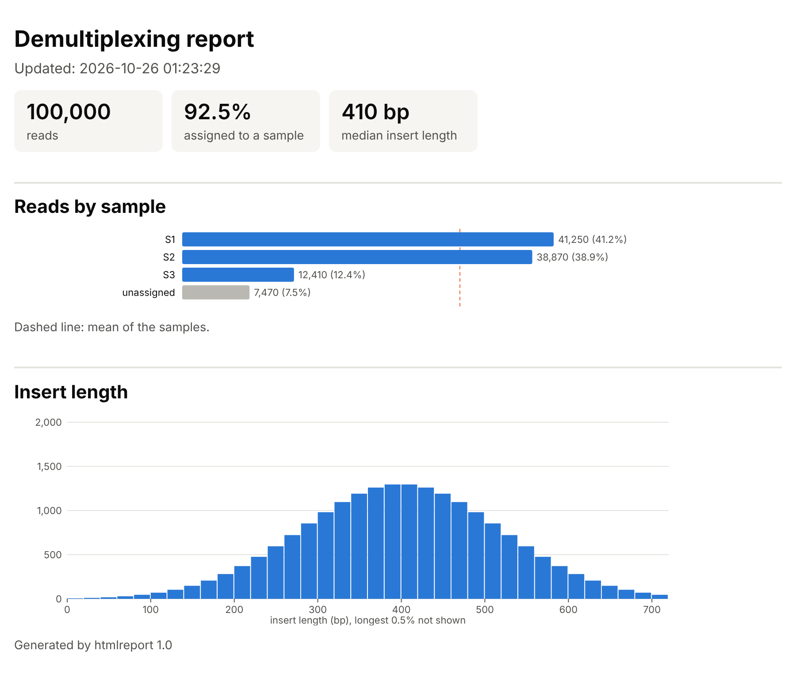

.. _io:

Large files and compression
---------------------------

The ``io`` component contains modules for handling large files: sorting
files which do not fit in memory, compressing output data in parallel,
and computing checksums; and the writing of the results of a program as
an HTML report (with an HTML element writer).

External sorting (``file-sorter.h``, ``file-merger.h``)
~~~~~~~~~~~~~~~~~~~~~~~~~~~~~~~~~~~~~~~~~~~~~~~~~~~~~~~

A file larger than the available memory is sorted in two steps:

1. ``sort_file_parts()`` reads the file in parts which fit in a buffer
   of a given size, splits each part into elements, sorts them, and writes
   them to the numbered temporary files ``<out><sfx>.0``, ``<out><sfx>.1``,
   ...; it returns the number of parts;
2. ``merge_n_files()`` merges the sorted parts, using a heap, into the
   output file ``<out><sfx>`` (or the standard output), deleting the
   parts.

The elements and their order are defined by functions passed by the
caller, so that any kind of record can be sorted. For text lines, the
splitting function is ``read_lines_in_buffer()`` of ``file.h``, which
returns pointers to the lines in the buffer (each line ends with
``\n``; the lines are not 0-terminated):

.. code-block:: c

   /* compare two lines (pointers to the line pointers) */
   static int cmp_lines(const void *a, const void *b) {
     const char *x = *(char *const *)a, *y = *(char *const *)b;
     size_t lx = strcspn(x, "\n"), ly = strcspn(y, "\n");
     int c = memcmp(x, y, lx < ly ? lx : ly);
     return c != 0 ? c : (lx > ly) - (lx < ly);
   }

   static void sort_lines(char **lines, size_t n) {
     qsort(lines, n, sizeof(char *), cmp_lines);
   }

   static void output_lines(FILE *file, char **lines, size_t n,
       Logger *logger) {
     for (size_t i = 0; i < n; i++)
       xfwrite(lines[i], 1, strcspn(lines[i], "\n") + 1, file, logger);
   }

   /* merging: the elements are read with xgetline() (0-terminated, with
      the newline) */
   static bool get_line(char **line, size_t *size, FILE *file,
       Logger *logger) {
     return xgetline(line, size, file, logger);
   }

   static void write_line(FILE *file, char *line, Logger *logger) {
     (void)logger;
     fputs(line, file);
   }

   static int cmp_line_ptrs(const void *a, const void *b) {
     return strcmp(*(char *const *)a, *(char *const *)b);
   }

   /* sort big.txt into big.txt.sorted, using a buffer of 1 GiB */
   size_t n_parts = sort_file_parts("big.txt", NULL, "big.txt", ".sorted",
       (size_t)1 << 30, 1024, read_lines_in_buffer, sort_lines,
       output_lines, logger);
   merge_n_files(n_parts, "big.txt", ".sorted", false, get_line,
       write_line, cmp_line_ptrs, logger);

The buffer must be larger than the longest line (otherwise the program
exits with a message suggesting a larger buffer).

Parallel compression (``gzip-compressor.h``, ``bgzf-compressor.h``)
~~~~~~~~~~~~~~~~~~~~~~~~~~~~~~~~~~~~~~~~~~~~~~~~~~~~~~~~~~~~~~~~~~~

Compressing the output is often the most expensive part of a read
processing program. The two compressors make it parallel, using a
property of the gzip format: **the concatenation of gzip members is a
valid gzip file**. Each block of output (e.g. the records of a batch) is
compressed independently, as a gzip member, by the thread which produced
it; the compressed blocks are then written to the file in the right
order (see :ref:`recipe-threads`).

.. code-block:: c

   gzip_compressor_t *gz = gzip_compressor_new(6);   /* level 1-9 */
   strbuf_t out;
   strbuf_init(&out);
   gzip_compressor_run(gz, text.s, text.len, &out);  /* appended to out */
   fwrite(out.s, 1, out.len, file);                  /* a gzip member */
   strbuf_free(&out);
   gzip_compressor_delete(gz);

Each thread uses its own compressor (the zlib stream state is reused
for all its blocks).

``bgzf-compressor.h`` does the same in the BGZF format of BAM files:
blocks of at most 64 KiB, each a gzip member with an extra field giving
its compressed size (so that BAM readers can seek). A BGZF file ends
with an empty block, the end-of-file marker ``bgzf_eof``
(``BGZF_EOF_LEN`` bytes), written after the last block:

.. code-block:: c

   bgzf_compressor_t *bgzf = bgzf_compressor_new(6);
   bgzf_compressor_run(bgzf, bam_data.s, bam_data.len, &out);
   ...
   fwrite(bgzf_eof, 1, BGZF_EOF_LEN, file);

The output files of several destinations (``outfiles.h``,
:ref:`outfiles`) write such compressed blocks, and add the BGZF
end-of-file marker to BAM files.

Checksums (``md5.h``)
~~~~~~~~~~~~~~~~~~~~~

The MD5 digest (RFC 1321) of data or of a file, as 32 lowercase
hexadecimal digits, e.g. for the checksums of files in metadata (such
as the ``md5`` of the onlists of seqspec files) or for checking
downloads; not for security purposes:

.. code-block:: c

   char hex[MD5_HEX_LEN + 1];
   md5_file("barcodes.txt.gz", hex, logger);   /* as md5sum */

   md5_t md5;                                  /* data in parts */
   md5_init(&md5);
   md5_update(&md5, data, len);
   md5_update(&md5, more, more_len);
   md5_final(&md5, hex);

.. _html-writer:

Writing HTML (``html-writer.h``)
~~~~~~~~~~~~~~~~~~~~~~~~~~~~~~~~

The markup of the HTML reports (:ref:`html-reports`), including their
inline SVG plots, is written by an element writer, ``html_writer_t``,
which a program can also use for its own content. It escapes the text and
the attribute values in one place, and indents the output, one element
per line, so that the nesting is visible in the code as in the page::

   html_writer_t w;
   html_writer_init(&w, f);
   html_open(&w, "table");
   html_open(&w, "tr");
   html_inline(&w);                         /* a row on one line */
   html_tag_text(&w, "td", name);           /* escaped */
   html_open(&w, "td");
   html_attr(&w, "class", "%s", "seq");
   html_textf(&w, "%zu", count);
   html_close(&w);
   html_close(&w);
   html_close(&w);
   html_writer_end(&w);

writes::

   <table>
     <tr><td>S1 &amp; S2</td><td class="seq">42</td></tr>
   </table>

``void html_open(html_writer_t *w, const char *tag)``
   starts an element; ``void html_close(html_writer_t *w)`` ends the
   innermost open element;
``void html_elem(html_writer_t *w, const char *tag)``
   an element without content and end tag: an HTML void element (e.g.
   ``img``, ``meta``) or, inside ``svg``, any element (written as
   ``<rect .../>``);
``void html_attr(html_writer_t *w, const char *name, const char *fmt, ...)``
   an attribute, with the value formatted as by ``printf()``, then
   escaped; the attributes follow ``html_open()`` or ``html_elem()``
   directly: the start tag is completed by the next call of any other
   function. Each attribute is a separate call, so that the compiler
   checks the format and arguments of each value (it could not check
   name and value pairs passed as variable arguments);
``void html_text(html_writer_t *w, const char *text)``, ``void html_textf(html_writer_t *w, const char *fmt, ...)``
   text, escaped; ``void html_raw(html_writer_t *w, const char *markup)``
   writes trusted markup in the same way, without escaping;
``void html_tag_text(html_writer_t *w, const char *tag, const char *text)``, ``html_tag_textf()``
   an element without attributes containing only text, e.g. a heading;
``void html_inline(html_writer_t *w)``
   writes the content of the element just started on the same line as
   its tags.

An element containing text is always written on one line, with all its
content (e.g. ``
see <code>out.tsv</code>
``), as a line break
between text and inline elements would add a space in the page.
``html_writer_end()`` checks that all elements were closed.

**Templates** (``html-template.h``). Static markup, e.g. the skeleton of
a page, is better written as an HTML file, indented normally, than as
C string literals: the file is embedded in the program at compile time
(see "Data files" in :ref:`installation`) and written by::

   html_template(w, page_tmpl, "title", title, "css", css,
                 "footer", footer);

with the values given as name and value pairs of strings. In the
template, ``{{name}}`` is replaced by the value, escaped; ``{{{name}}}`` by
the value as it is (trusted markup); the text between ``{{#name}}`` and
``{{/name}}`` (a section) is written only if the value is not ``NULL``;
a line containing only a section tag is not written::

   <!-- (c) 2026 Name (comment lines are not embedded) -->
   <title>{{title}}</title>
   
   {{#footer}}
   
{{footer}}

   {{/footer}}

The template is indented as the current element of the writer, and the
lines of a multi-line value as the line of its placeholder (a newline at
the end of the value is dropped). A placeholder without a value, a value
not used, a ``NULL`` value outside of its section and an invalid tag
(names: lower case letters, digits and ``_``) are programming errors: the
program is aborted with a message, also when compiled with ``NDEBUG``, so
that any test writing the template finds them.

.. _html-reports:

HTML reports (``html-page.h``)
~~~~~~~~~~~~~~~~~~~~~~~~~~~~~~

A program can summarize its results in an HTML report, to be opened in a
browser. The pages are **self-contained**: the style is included in the
page and the plots are inline SVG (JavaScript only for the reload of a
report rewritten during a run), so that a report can be copied or sent
as a single file, and viewed offline; the style follows the light or
dark theme of the browser. A report is written by an element writer
(:ref:`html-writer`), with which the program also writes its own content:

``void html_page_start(html_writer_t *w, const char *title, long refresh)``
   the head of the page (title, style) and the start of the body: the
   title as ``h1`` heading, and the time of writing ("Updated: ...");
   if ``refresh`` > 0, the browser reloads the page (for a report
   rewritten during a run, see :ref:`recipe-realtime`), at an adaptive
   interval: halved, down to 1 s, when the page has changed since the
   last reload, doubled, up to ``refresh`` seconds, when not (a few lines
   of JavaScript; without it, every ``refresh`` seconds);
   or ``void html_page_start_logo(html_writer_t *w, const char *title, const html_logo_t *logo, const char *heading, long refresh)``,
   a head in two columns: on the left, a logo with ``heading`` under it
   (bold spaced capitals, centered; e.g. "report", under the name shown by
   the logo), centered over the time of writing; on the right, the content written next
   (e.g. a table of the parameters), up to
   ``void html_page_head_end(html_writer_t *w)`` (on narrow screens, the right
   column goes below the left one). The logo (``html_logo_t``) is an
   image URL ``src``, usually a data URI (``data:image/webp;base64,...``)
   to keep the page self-contained, an optional variant for the dark
   theme ``src_dark`` (``NULL``: none), the alternative text ``alt`` and
   the ``height`` in pixels;
the content
   written by the program with the writer (headings ``h2``, paragraphs,
   tables), and the functions below for the tiles and the plots;
``void html_page_end(html_writer_t *w, const char *footer)``
   the end of the page, with a footer note (``NULL``: none); the
   elements opened by the content must have been closed.

**Reports and dashboards.** A report is a vertical page, to be read,
printed or archived (e.g. at the end of an analysis). A page followed
on a screen during a run is better laid out as a **dashboard**, which
fits the window, so that everything is visible at once:

``void html_dashboard_start(html_writer_t *w, const char *title, const html_logo_t *logo, const char *heading, long refresh)``
   the head of the page and a top bar: the logo (``NULL``: none), with
   ``heading`` under it and the time of writing, then the content
   written next (e.g. the state and the parameters of the run), up to
   ``void html_dashboard_bar_end(html_writer_t *w)``; ``refresh``: as above;
the content
   e.g. tiles (``div.tiles``) and a grid of panels (``div.dgrid``: three
   columns, rows of equal height filling the window);
``void html_panel_start(html_writer_t *w, const char *title, const char *cls)``
   a panel, with a title (``h3``); ``cls``: ``"tall"`` (two rows),
   ``"wide"`` (two columns) or ``NULL``; its content scrolls if needed;
   ``void html_panel_end(html_writer_t *w)`` ends it;
``html_page_end()``
   as for a report.

On narrow (or low) windows, the panels follow each other and the page
scrolls. The plots (below) are scaled to the width of the panels.

The content:

``void html_tile(html_writer_t *w, const char *value, const char *label)``
   a tile with a main value and its label (text); the tiles are written
   inside a ``
``, which shows them in a row;
``void html_hbars(html_writer_t *w, size_t n, const char *const *labels, const size_t *values, const char *const *classes, size_t total, double mean)``
   a horizontal bar chart: for each of the ``n`` values, its label, a bar
   and the value with its percentage of ``total``; ``classes[i]`` is the
   class of the bar: ``"s"`` (main color, e.g. the samples) or ``"p"``
   (muted, e.g. the unassigned reads); if ``mean`` > 0, a dashed line at
   that value;
``void html_histogram(html_writer_t *w, const size_t *hist, size_t n_bins, size_t bin_width, const char *what, const char *unit, const char *empty)``
   a histogram of counts in bins of width ``bin_width`` (> 0; bin ``b``: the
   values from ``b * bin_width`` to ``(b + 1) * bin_width - 1``, as for
   ``hist_median()``), up to the bin of the 99.5th percentile; the x axis
   is labelled ``what (unit)``; if all counts are 0, the note ``empty`` is
   written instead;
``void html_knee(html_writer_t *w, const uint64_t *counts, size_t n, size_t n_selected, const char *x_label, const char *y_label, const char *selected_label)``
   a rank plot ("knee plot", log-log): counts in decreasing order (e.g.
   the reads of the barcodes, from ``cell_caller_sorted_counts()``), with
   the axes titled ``x_label (log scale)`` and ``y_label (log scale)``,
   and a dashed line at the rank ``n_selected`` (0: none; at most at the
   last rank, ``n``), labelled with the number and ``selected_label``;
   e.g. for the cells of a
   single-cell library::

      html_knee(w, counts, n, n_cells, "barcodes, by decreasing number "
                "of reads", "reads", "cells");

``html_num_t html_num(size_t n)``
   a number with thousands separators (``1,234,567``), for the text of
   the report, in the string ``html_num(n).s``: the result is a small
   structure returned by value (not a static buffer), valid up to the end
   of the statement, so that any number of them can be used in one call,
   e.g. ``html_textf(w, "%s of %s", html_num(a).s, html_num(b).s)``;
``double html_percent(size_t a, size_t b)``
   ``100 * a / b`` (0 if ``b`` is 0).

All strings given to these functions (titles, labels, values of the
tiles, notes) are text, escaped by the writer. ``html_page_css`` contains
the style, e.g. for a page written otherwise; besides the headings and
tables (numbers right-aligned), it defines the classes ``p.sub``
(subtitle), ``p.note`` (small, muted text), ``p.running`` (a highlighted
box, e.g. "run in progress") and ``td.seq`` (sequences, in monospace),
and the colors as CSS variables (e.g. ``--primary`` and ``--secondary``,
the colors of the bars of the classes ``s`` and ``p``). The style is
written in ``src/io/html-page.css``, and the static parts of the pages
(the head, the heading with the logo, the end) are templates in
``src/io/html-page-*.html``; the Makefile of the library embeds them in
``html-page.c``.

The example program ``htmlreport`` (``docs/manual/examples/htmlreport.c``)
writes the report of a demultiplexer (with example values,
:numref:`fig-html-report`):

.. literalinclude:: examples/htmlreport.c
   :language: c
   :start-at: FILE *f = xfopen
   :end-at: xfclose

.. _fig-html-report:

   The report written by ``htmlreport``, in a browser (light theme).
