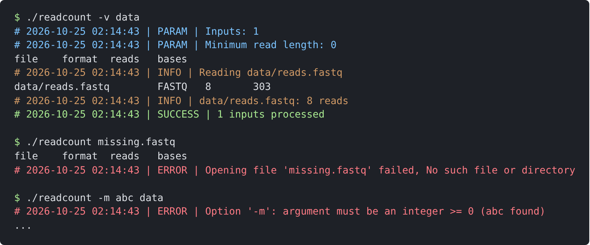

.. _quickstart:

A first program
---------------

This chapter walks through a complete program using libcbaia:
``readcount``, which counts the reads and bases of FASTQ or BAM files, or
of the files of reads in directories (e.g. the ``fastq_pass`` directory
of a Nanopore run). The source is in ``docs/manual/examples/readcount.c``
of the repository, and is built and tested by ``make test``.

The program
~~~~~~~~~~~

.. literalinclude:: examples/readcount.c
   :language: c
   :lines: 8-

The parts of the program
~~~~~~~~~~~~~~~~~~~~~~~~

**The help message.** ``PURPOSE`` is the help text, with ``%s`` for the
name of the program. It ends with ``COMMON_OPTS_HELP``, the description of
the options common to all programs (verbosity, log file, help,
version). The ``// %-PURPOSE-%`` comment marks it, so that scripts can
find it (e.g. to copy the help into the documentation). ``XSTR`` turns
the value of a macro into a string, so that the defaults in the help are
always those of the code.

**Parsing the command line.** ``parseargs()`` follows the pattern of
all programs (see :ref:`argparse`):

1. ``PARSE_START`` declares the variables of the common options;
2. the outputs are set to their defaults;
3. the options are parsed with ``getopt_long()``; the string of the
   short options ends with ``COMMON_OPTS_STR``, the table of the long
   options with ``COMMON_LONGOPTS`` and ``LONGOPTS_END``, and the
   ``switch`` with ``COMMON_OPTS_PARSE_CASES``, which handle the common
   options;
   ``PARSE_INTEGER_OPT_MIN`` parses an integer, checking its minimum;
4. ``CHECK_MIN_NARGS`` checks the number of positional arguments;
5. ``INIT_LOGGER`` creates the logger, with the level given by the
   options (``-q``, ``-v``, ``-D``) and the log file (``-g``);
6. ``PARSE_LOG`` writes the values of the parameters to the log, in the
   verbose mode.

Errors in the options (an unknown option, a missing or invalid value,
a wrong number of arguments) are reported with the usage message, and
the program exits.

**Reading the files.** ``reads_reader_new()`` opens a FASTQ (optionally
gzipped) or BAM file, recognized from its content, and
``reads_reader_read_batch()`` reads its records in batches
(``fastq_batch_t``): the records of a batch are stored in one buffer
(``batch.data``), and each record (``fastq_record_t``) gives the
positions and lengths of its title, sequence and qualities in it. A
batch is reused for all files, so that no memory is allocated for each
record. If a file cannot be read, or is not valid, the program exits
with a message giving the file and the problem.

**Directories.** ``is_directory()`` and ``list_dir()`` (``file.h``)
list the files of a directory in lexicographic order, selected by a
filter function, here the files of reads
(``reads_reader_is_reads_filename()``: by their suffix).

**Messages.** The results go to the standard output; the messages to the
logger: ``lprintf(logger, LOG_INFO, ...)`` is shown only in the verbose
mode, ``LOG_SUCCESS`` unless ``-q`` is given, ``LOG_WARN`` always.

**Freeing the memory.** All objects are deleted before exiting: the
programs are tested under valgrind, which reports memory leaks.

Building and running
~~~~~~~~~~~~~~~~~~~~

The examples are built by ``docs/manual/examples/Makefile``, which uses
the copy of the library of the repository in the same way as a project
vendoring it (see :ref:`installation`)::

   cd docs/manual/examples
   make
   ./readcount data

On a terminal, the messages of the logger are colored by level
(:numref:`fig-term-readcount`): the parameters (``-v``) in blue, the
information messages in orange, the success messages in green, the
errors in red. The results (the table of the counts) go to the standard
output, uncolored, and can be redirected to a file without the messages.

.. _fig-term-readcount:

   ``readcount`` on a terminal: a verbose run (``-v``), a missing input
   file, and an invalid option value (followed by the usage, cut here).
   Each error interrupts the program with exit code 1.

The help, with the common options added by ``COMMON_OPTS_HELP``:

.. code-block:: none

   $ ./readcount -h
   Count the reads and bases of FASTQ or BAM files

   Usage:
      ./readcount [options] <input>...

   Arguments:
      <input>  FASTQ (optionally gzipped) or BAM file, or a directory
               (its files of reads are counted)

   Options:
      -m, --min-length <n>  count only the reads of at least <n> bases
                            (default: 0)

   Verbosity options: (only one can be used)
      (default)            success, warning and error messages to stderr
      -q, --quiet          quiet: suppress success messages
      -v, --verbose        verbose: show additional info messages
      -D, --debug          debug: show some debug information
      -g, --logfile F      print messages to file (default: stderr)

   Other options:
      -h, --help           show this help message and exit
      -V, --version        output version and exit

The long options (``--min-length``, ``--quiet``, ...) are available
because the program parses the options with ``getopt_long()``, with the
table of the long options ending with ``COMMON_LONGOPTS`` (see
:ref:`argparse`).

A larger example, a demultiplexer of reads by a barcode, using the
barcode whitelist, the output files and the parallel compression, is
described in :ref:`recipes`.
