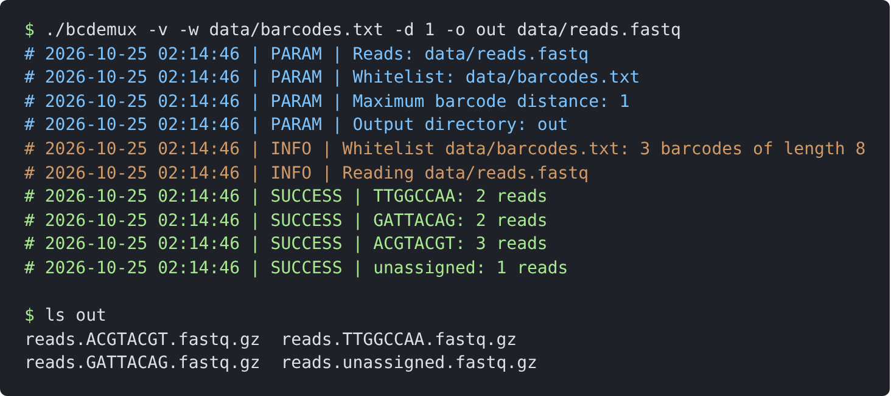

.. _recipes:

Recipes
-------

This chapter shows how the modules work together in typical tasks of
read processing programs.

.. _recipe-demux:

A barcode demultiplexer
~~~~~~~~~~~~~~~~~~~~~~~

``docs/manual/examples/bcdemux.c`` demultiplexes the reads of a FASTQ or
BAM file by a barcode at their start: the barcode is corrected using a
whitelist, removed from the read, and the read is written to the file of
its barcode (or to that of the unassigned reads). In about 200 lines,
the program uses the command line interface, the logger, the reads
reader, the whitelist, khash, the FASTQ writer, the gzip compressor and
the output files:

.. literalinclude:: examples/bcdemux.c
   :language: c
   :lines: 11-

Running it on the example data (8 reads, 3 barcodes of 8 bases;
:numref:`fig-term-bcdemux`): of the reads, three have a barcode with an
error (a substitution, or a deletion), which is corrected; one read has
no barcode of the whitelist within the maximum distance, and is written
to ``reads.unassigned.fastq.gz``.

.. _fig-term-bcdemux:

   ``bcdemux`` on the example data, in the verbose mode: the parameters,
   the whitelist read (``whitelist_new()`` reports its size), the input
   file opened by the reads reader, the counts, and the output files.

The structure is that of most read processing programs:

1. the destinations are set up: here the barcodes of the whitelist plus
   ``unassigned``; a khash map gives the destination of each encoded
   barcode;
2. the reads are read in batches; for each read, the destination is
   computed, and the output record is appended to the buffer
   (``strbuf_t``) of its destination;
3. after each batch, the buffer of each destination is compressed (a
   gzip member) and written to its file by ``outfiles_write()``; the
   buffers are cleared and reused for the next batch.

No memory is allocated for each read: the batch, the buffers of the
destinations and the compressor are reused. The same structure, with the
work of step 2 and the compression of step 3 done by several threads,
gives a parallel program.

.. _recipe-threads:

Multithreaded processing
~~~~~~~~~~~~~~~~~~~~~~~~

The modules have no global state, and the compressors produce
independent gzip members: a read processing program is parallelized by
giving each thread its own objects (batch, output buffers, compressor,
counters) and synchronizing only the input and the output
(:numref:`fig-threads`):

* **input**: a thread takes the lock of the reader, reads the next batch
  and its number, and releases the lock;
* **processing**: the thread processes its batch and compresses the
  output of each destination, without any lock (this is where the time
  is spent);
* **output**: the thread waits until the batches before its own have
  been written (a counter of the next batch to write, and a condition
  variable), writes its compressed blocks, merges its counters into the
  totals, increments the counter and wakes the other threads.

.. _fig-threads:

.. figure:: figures/threads.*
   :width: 100%

   Multithreaded processing of a file of reads: the threads read the
   batches in turn, process and compress them in parallel, and write
   them in the order of the input.

As the output is written in the order of the input, it does not depend
on the number of threads: the same input gives byte-identical output
files with 1 or 16 threads, which makes the program testable. The
skeleton of a worker thread:

.. code-block:: c

   typedef struct {
     reads_reader_t *reader;
     pthread_mutex_t input_mutex, output_mutex;
     pthread_cond_t output_cond;
     size_t next_batch, next_to_write;
     outfiles_t *outfiles;
   } job_t;

   typedef struct {
     job_t *job;
     fastq_batch_t batch;
     strbuf_t *outputs, *compressed;   /* one for each destination */
     gzip_compressor_t *compressor;
     size_t n_destinations;
   } worker_t;

   static void *worker_run(void *data) {
     worker_t *w = data;
     job_t *job = w->job;
     for (;;) {
       /* input */
       pthread_mutex_lock(&job->input_mutex);
       size_t n = reads_reader_read_batch(job->reader, &w->batch, 10000);
       size_t batch_num = job->next_batch++;
       pthread_mutex_unlock(&job->input_mutex);
       if (n == 0)
         break;
       /* processing and compression, in parallel */
       for (size_t i = 0; i < n; i++)
         process_record(w, &w->batch.records[i]);   /* -> w->outputs[d] */
       for (size_t d = 0; d < w->n_destinations; d++) {
         strbuf_clear(&w->compressed[d]);
         if (w->outputs[d].len > 0)
           gzip_compressor_run(w->compressor, w->outputs[d].s,
                               w->outputs[d].len, &w->compressed[d]);
         strbuf_clear(&w->outputs[d]);
       }
       /* output, in the order of the batches */
       pthread_mutex_lock(&job->output_mutex);
       while (job->next_to_write != batch_num)
         pthread_cond_wait(&job->output_cond, &job->output_mutex);
       for (size_t d = 0; d < w->n_destinations; d++)
         if (w->compressed[d].len > 0)
           outfiles_write(job->outfiles, d, name(d), w->compressed[d].s,
                          w->compressed[d].len);
       job->next_to_write++;
       pthread_cond_broadcast(&job->output_cond);
       pthread_mutex_unlock(&job->output_mutex);
     }
     return NULL;
   }

(the batch number is taken also when the end of the file is reached, so
that the numbers of the batches with data are consecutive). The worker of
Lumipore (``src/worker.c`` of its repository) follows this scheme, and
processes about 60,000 Nanopore reads per second with 4 threads.

Statistics are accumulated by each thread in its own counters, merged
under the output lock; the same holds for the sketches
(``hll_merge()``) and the cell callers (``cell_caller_merge()``).

Processing a sequencing run in real time
~~~~~~~~~~~~~~~~~~~~~~~~~~~~~~~~~~~~~~~~

A sequencer writes the files of reads while the run progresses (e.g.
MinKNOW writes a file every few minutes in each ``fastq_pass/barcodeNN``
directory). A program processing them in real time polls the
directories, and processes each new file once it is complete:

.. code-block:: c

   static bool reads_file(const char *name, const char *path, void *d) {
     (void)d;
     return reads_reader_is_reads_filename(name) && !is_directory(path);
   }

   for (;;) {
     size_t n;
     char **files = list_dir(dir, reads_file, NULL, &n, logger);
     for (size_t i = 0; i < n; i++) {
       struct stat st;
       if (!already_processed(files[i]) &&
           stat(files[i], &st) == 0 &&
           difftime(time(NULL), st.st_mtime) >= MIN_AGE &&
           reads_reader_file_complete(files[i]))
         process(files[i]);   /* e.g. with outfiles_set_append() */
       free(files[i]);
     }
     free(files);
     sleep(10);
   }

``reads_reader_file_complete()`` checks the content (a complete gzip
stream ending with a newline, or a BAM file with the end-of-file
marker), so that a file which is still being written is not processed;
the minimum age protects against files whose writing pauses. The output
files are opened in append mode (``outfiles_set_append()``), so that
the reads of each new file are appended to the outputs.

A two-pass analysis of single-cell reads
~~~~~~~~~~~~~~~~~~~~~~~~~~~~~~~~~~~~~~~~

For single-cell libraries, the barcodes are best corrected using the
barcodes of the cells, which are not known in advance. The cell caller
(:ref:`barcodes`) is used in a first pass over the reads, counting the
barcodes of the whitelist of the platform found exactly; the cells are
then selected, and the reads are processed in a second pass, correcting
the barcodes using the cells only. The first pass needs only the
barcodes (e.g. the first bases after an adaptor), and can be made
parallel in the same way as the processing, with a cell caller for each
thread, merged at the end.
